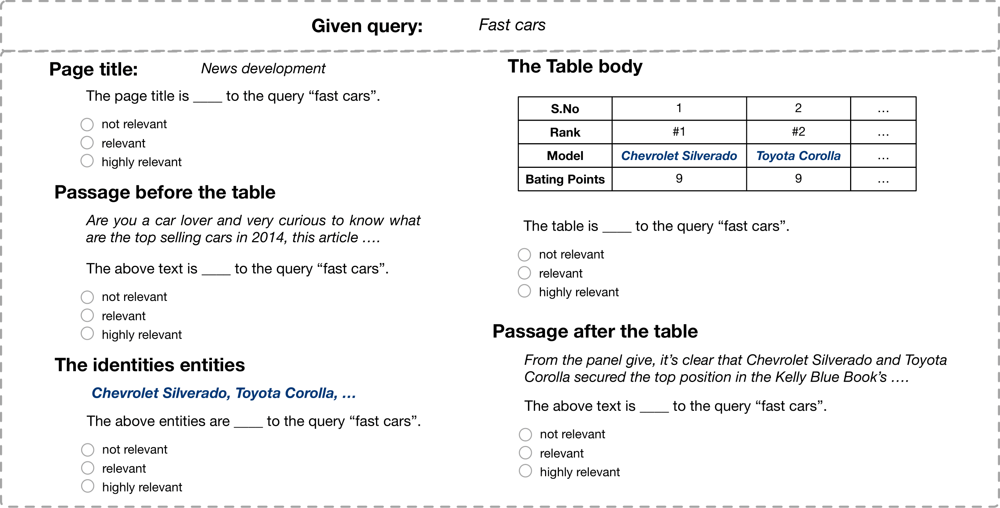

# Colección de pruebas WTR

La colección de pruebas de recuperación de tablas web (WTR) es un punto de referencia para la recuperación de tablas basado en un corpus de tablas web a gran escala extraído de Common Crawl.
Cada tabla en WTR cuenta con un contexto enriquecido (título de la página, entidades, texto antes/después de la tabla).
Por lo tanto, no solo proporcionamos juicios de relevancia para pares consulta-tabla, sino también para pares consulta-contexto de la tabla.



# Resumen del conjunto de datos


## Juicios de relevancia

Los siguientes archivos contienen juicios de relevancia para pares consulta-tabla/contexto.


|                                                                           Descripción                                                                           |             Ubicación            |
|:---------------------------------------------------------------------------------------------------------------------------------------------------------------:|:-------------------------------:|
| Juicio de relevancia para pares consulta-tabla. Corresponde a <br> las anotaciones de colecciones de pruebas anteriores (p. ej., [WikiTables](https://github.com/iai-group/www2018-table)).   | ./data/rel_table_qrels.txt      |
| Juicio de relevancia para pares consulta-título de página.                                                                                                                  | ./data/rel_PageTitle_qrels.txt  |
| Juicio de relevancia para pares consulta-entidades.                                                                                                                    | ./data/rel_entity_qrels.txt     |
| Juicio de relevancia para pares consulta-textoDespués.                                                                                                                   | ./data/rel_textAfter_qrels.txt  |
| Juicio de relevancia para pares consulta-textoAntes.                                                                                                                  | ./data/rel_textBefore_qrels.txt |


## Volcados de tablas y consultas


|                                           Descripción                                          |                                   Ubicación                                  |
|:----------------------------------------------------------------------------------------------:|:---------------------------------------------------------------------------:|
| El mismo conjunto de 60 consultas utilizado en [WikiTables](https://github.com/iai-group/www2018-table).   | ./data/queries.txt                                                          |
| El conjunto de contenido sin procesar de las tablas en los resultados de pooling.                                            | ./data/wdc_pool.json.tar.gz                                                 |
| La versión completa del volcado de tablas WTR procesado (con resultados de vinculación de entidades).                    | [haz clic para descargar](http://www.cse.lehigh.edu/~brian/data/WTR_tables.tar.gz) |


## Divisiones para validación cruzada

Proporcionamos las divisiones de datos en 5 pliegues bajo "./data/" y cada archivo se denomina "fold_split.jsonl".
Por ejemplo, "1_train.jsonl" es el conjunto de entrenamiento para el pliegue 1.
Nuestras líneas base se entrenan/prueban en esas divisiones de datos para una validación cruzada de 5 pliegues. 
En cada registro de un archivo JSON, proporcionamos la consulta, el contenido de la tabla y la etiqueta (la etiqueta se encuentra en ./data/rel_table_qrels.txt).
 
 
## Línea base


Los rankings de las líneas base se encuentran bajo "./rankings/". Excepto la carpeta "pool", cada una de las demás carpetas está nombrada según un método base e incluye los resultados de ranking correspondientes en dicha carpeta.

Las características STR se guardan en "./data/wdc_STR.csv". Las primeras 9 características del archivo son características de LTR.

# Replicación

A continuación, describimos cómo procesar el corpus WDC original sin procesar y obtener los resultados de pooling.


## Entorno

Utilizamos [elasticsearch 5.3](https://www.elastic.co/downloads/past-releases/elasticsearch-5-3-0) para indexar el corpus.
Por favor, ejecute el servidor al indexar y obtener los resultados de pooling.

Además, tenemos los siguientes paquetes instalados con Python 3.7:

```angular2html
pandas 0.25.3
elasticsearch 5.5.3
nltk 3.4.5
numpy 1.17.4
scipy 1.5.2

```

## Preprocesamiento e indexación

Para replicar e indexar el volcado de tablas WTR, hay tres pasos: 

1. descargue los archivos de volcado wdc desde file_list:
```
    wget -i file_list.txt
```
2. empareje los volcados wdc descargados con los resultados de vinculación de entidades (disponibles [aquí](https://zenodo.org/record/3627274#.YD31RS2cbcI) ) de "Novel Entity Discovery from Web Tables, WWW 2020":
```
    python extract.py
```
3. cree el índice (con elasticsearch ejecutándose como backend):
```
    python indexer.py
```

Verifique las rutas de datos/estructuras de carpetas en "metadata.py".
Por conveniencia, proporcionamos el volcado de tablas WTR procesado [aquí](http://www.cse.lehigh.edu/~brian/data/WTR_tables.tar.gz). Puede indexar directamente este archivo (es decir, paso 3).


## Resultados de pooling

Puede obtener los resultados iniciales de los 20 mejores de las líneas base no supervisadas (BM25 en diferentes campos) ejecutando:
```
    python pool_ranker.py
```
Los resultados de ranking en formato TREC se guardan bajo "./ranking/pool/". El nombre del archivo corresponde al campo.
También proporcionamos las tablas de pooling en "./data/wdc_pool.json.tar.gz" 
donde puede acceder al contenido sin procesar de la tabla según el identificador de la tabla.


### Agradecimientos
La implementación de la interfaz de elasticsearch (elastic.py, elastic_cache.py, scorer.py) fue adaptada de [Nordlys](https://github.com/iai-group/nordlys).
